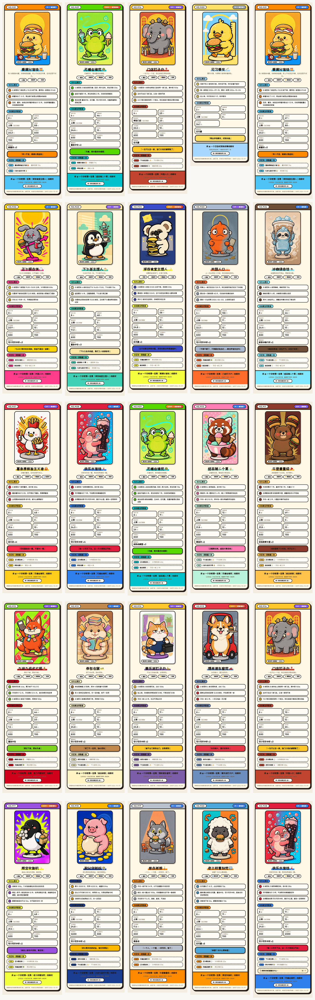
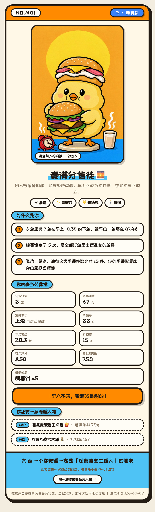
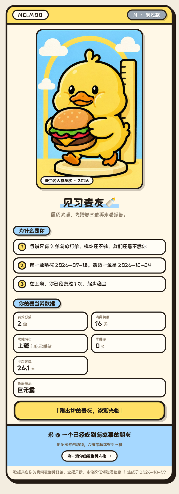
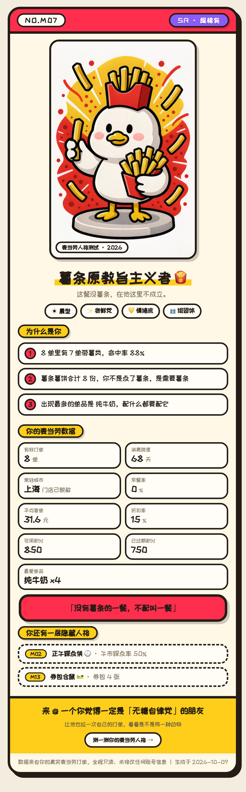
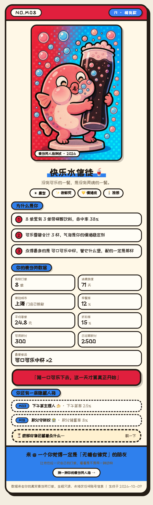

# 麦当劳人格测试 · mcd-personality

> 把你的麦当劳订单，变成一张能晒出去的「人格收藏卡」。
> 全程只读：只拉数据，不下一单、不花一分、不领一张券。



## 这是什么

一个基于**麦当劳中国官方 MCP** 的 Skill（WorkBuddy / 兼容 SKILL.md 规范的 Agent 均可加载）。

它把你真实的麦当劳订单当作一次行为侧写：读取订单、积分、奖品、券包四类数据，算出 **66 维行为特征**，在 **20 种主格人格**里判定你的主格（另有 1 种兜底人格与 1 个隐藏彩蛋），再渲染成一张 1024×3367 的收藏卡式长图。

每条结论都能回溯到订单里的真实字段——**不许编**。卡片上写的「10 单里有 5 单在早上 10:30 前下单」，就是真的有 5 单。

### 22 个人格条目怎么来的（20 主格 + 1 兜底 + 1 彩蛋）

| 族 | 人格 |
|---|---|
| 时间 | M01 麦满分信徒 · M02 正午踩点侠 · M03 下午茶主理人 · M04 深夜食堂主理人 · M05 失踪人口 |
| 品类 | M06 冰咖续命徒 · M07 薯条原教旨主义者 · M08 快乐水信徒 · M09 无糖自律党 · M10 甜品第二个胃 · M11 牛堡重量级 |
| 行为 | M12 九块九战术大师 · M13 券包仓鼠 · M14 麦乐送钉子户 · M15 得来速车窗党 · M16 门店钉子户 |
| 资产 | M17 限定收割机 · M18 积分守财奴 · M19 单点孤狼 · M20 老三样复刻党 |
| 兜底 | M00 见习麦友（有效订单 < 3 单时降级） |
| 彩蛋 | MX 过期冤种（积分过期率 ≥ 50% 且过期 ≥ 1000 分时，进底部彩蛋区，不占主格） |

同族互斥：四族各只留最高分；最高分不足 25 分降级 M00；与主格跨族且 ≥ 40 分的次高最多 2 个，作为隐藏副格。

## 效果预览

| 主格卡 | 兜底卡 |
|---|---|
|  |  |

| 品类卡 | 彩蛋卡 |
|---|---|
|  |  |

演示视频（58 秒，1080p）：[`docs/demo.mp4`](./docs/demo.mp4)

## 目标用户

- **普通麦门用户**：想看看自己的点单习惯到底有多离谱，或者想要一张能发朋友圈/小红书的年度报告式卡片
- **内容创作者**：需要一个低成本、强互动的社群话题（卡片底部自带「@ 一个你觉得一定是 XX 的朋友」）
- **开发者**：想参考一套「只读 MCP 调用 + 数据脱敏 + 长图渲染」的完整链路，以及 25 份可离线复现的 mock 数据

## 安装方法

### 1. 申请麦当劳 MCP Token

到 [open.mcd.cn/mcp](https://open.mcd.cn/mcp) 用手机号登录，在控制台点击「激活」申请 Token。
官方使用指南：[M-China/mcd-mcp-server](https://github.com/M-China/mcd-mcp-server)。

> 本项目**只需要 Token 对应的只读查询权限**，不涉及下单、领券、抽奖等写操作。

### 2. 配置 MCP

复制配置示例，把 Token 放进环境变量，**不要写进文件**：

```bash
cp mcp-config.example.json ~/.workbuddy/mcp.json
export MCD_MCP_TOKEN="你的 Token"
```

内容见 [`mcp-config.example.json`](./mcp-config.example.json)，只有 `${MCD_MCP_TOKEN}` 占位符。

### 3. 安装 Skill

```bash
git clone https://github.com/xiaobaiTech/mcd-personality.git ~/.workbuddy/skills/mcd-personality
```

依赖：

| 依赖 | 用途 | 是否必须 |
|---|---|---|
| Python 3.9+ | 全部脚本 | 必须 |
| Pillow | 图片处理与长图裁剪 | 必须 |
| Chrome / Chromium / Edge | 长图截图（`shot.py`） | 出图必须，只看 HTML 可不要 |

### 4. 开始使用

在 WorkBuddy 对话里直接说：

```
测测我的麦当劳人格
```

Agent 会自动拉数据、判定人格、出卡，并把 `report.png` 交给你。

## 使用示例

### 走真实数据（需登录麦当劳账号）

Agent 侧的调用顺序（详见 [`MCP_INTEGRATION.md`](./MCP_INTEGRATION.md)）：

```text
order-list → query-order（逐单） → query-my-account → query-my-prizes → query-my-coupons → query-lottery-info（可选）
```

原始返回存进 `raw/` 后，一条命令跑完：

```bash
bash scripts/run.sh raw/ out/
# 产出 out/{raw.json, features.json, result.json, report.html, report.png}
```

### 完全离线（不打 MCP，也不需要账号）

仓库自带 mock 数据生成器，可复现全部 22 个人格条目（20 主格 + 兜底 + 彩蛋）+ 3 个边界场景：

```bash
# 1) 造 25 份「MCP 原始返回」快照
python3 scripts/make_fixtures.py --out /tmp/fixtures

# 2) 全部跑一遍，产出验证表 + 卡片画廊
python3 scripts/verify_all.py /tmp/fixtures /tmp/verify-out
```

预期结果：**25/25** 全部命中期望人格。改了人格库之后重跑一遍，就能一次看出哪张卡坏了。

## 工作原理

```text
MCP 只读接口 → raw/*.json → fetch.py 规整脱敏 → analyze.py 66 维特征
             → judge.py 判定人格+生成文案 → render.py 单文件 HTML → shot.py 长图 PNG
```

- **判定**：每个条件算「超标比」，同组取最大（OR）、跨组加权平均（AND），`gate` 条件不达标直接出局
- **文案**：3 条理由全部由真实字段套模板生成，缺数据就少一条，不补齐
- **渲染**：HTML 单文件自包含（图片、字体全部 base64 内嵌），断网也能打开

## 隐私与合规

| 项 | 做法 |
|---|---|
| 接口权限 | 只用 6 个只读接口，硬约束禁止调用 `create-order` / `cancel-order` / `draw-lottery` / `auto-bind-coupons` 等写操作 |
| 门店信息 | 门店名/编码/地址不落盘不渲染，只保留城市；门店去重用 `storeCode` 的 md5 前 8 位 |
| 凭证 | 仓库内不含任何真实 Token / 密钥 / 账号，配置仅用环境变量占位符 |
| 数据出境 | 全部处理在本机完成，不上传任何第三方 |
| 样本不足 | 有效订单 < 3 单直接判 M00，不硬凑结论 |

## 已知限制

- MCP 的 `order-list` 只返回最近若干单，样本太少的账号会落到 M00 兜底卡
- 部分券全额抵扣的单，`realTotalAmount` 会返回 0 或 1，客单价统计会剔除这些单
- `query-my-coupons` 返回的是 Markdown 而非 JSON，靠正则解析；解析失败记 0，不阻塞出卡
- 奖品名是节气测试名（立春/白露等），只取数量与类型，不做语义判断

## 目录结构

```text
mcd-personality/
├── SKILL.md                    # Skill 定义与使用流程（Agent 读这个）
├── README.md                   # 本文件
├── MCP_INTEGRATION.md          # MCP 调用说明
├── CONTEST_DECLARATION.md      # 参赛声明（官方原样文件）
├── mcp-config.example.json     # 脱敏 MCP 配置示例
├── workbuddy.md                # WorkBuddy 开发上下文
├── scripts/                    # fetch / analyze / judge / render / shot / mock
├── references/                 # 人格库、数据契约、生图提示词
├── templates/report.html       # 报告卡模板
├── assets/personas/            # 22 张人格插画
└── docs/                       # 预览图与演示视频
```

## 许可

代码 [MIT License](./LICENSE) 授权。人格插画为本项目原创生成素材，随项目一同以 MIT 授权。

本项目是麦当劳程序员创意开发大赛的参赛作品，由参赛者独立开发，**非麦当劳官方产品**。
项目输出仅供参考，餐品信息、价格及供应状态以麦当劳官方渠道的实时结果为准。
